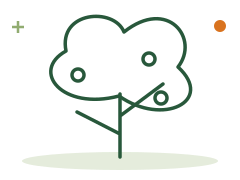

<div class="gp-tree-hero">
  <div>
    <span class="gp-tree-eyebrow">CONHECIMENTO QUE CRESCE EM REDE</span>
    <p><strong>O GPENSC é o tronco</strong> que integra pesquisa, ensino e extensão. As linhas de pesquisa e seus projetos formam os galhos; as pessoas e as produções científicas representam os frutos desse trabalho coletivo.</p>
  </div>
  
</div>

```{r}
source("R/helpers.R")
linhas_arvore <- registros_reais(linhas, "nome")
projetos_arvore <- registros_reais(projetos, "titulo")
pubs_arvore <- registros_reais(pubs, "titulo")
defesas_arvore <- registros_reais(defesas, "titulo")
pessoas_arvore <- registros_reais(equipe, "nome")

por_linha <- function(dados, id) {
  if (nrow(dados) == 0 || !("linha_id" %in% names(dados))) return(dados[0, , drop = FALSE])
  dados[!is.na(dados$linha_id) & as.character(dados$linha_id) == id, , drop = FALSE]
}
pessoas_por_linha <- function(id) {
  if (nrow(pessoas_arvore) == 0 || !("linhas_ids" %in% names(pessoas_arvore))) {
    return(pessoas_arvore[0, , drop = FALSE])
  }
  mask <- vapply(seq_len(nrow(pessoas_arvore)), function(j) {
    raw <- pessoas_arvore$linhas_ids[j]
    if (!tem(raw)) return(FALSE)
    ids <- trimws(unlist(strsplit(as.character(raw), "[|,;]")))
    id %in% ids && !identical(valor_publico(pessoas_arvore$categoria[j]), "Egressos")
  }, logical(1))
  pessoas_arvore[mask, , drop = FALSE]
}
lista_de_vinculos <- function(df, campo, tipo = "") {
  if (nrow(df) == 0) return(NULL)
  tags$ul(class = "gp-tree-links", lapply(seq_len(nrow(df)), function(j) {
    titulo <- as.character(df[[campo]][j])
    url <- if (tipo == "pessoas") valor_publico(df$lattes[j]) else
      if (tipo == "publicacoes") valor_publico(df$url[j]) else NULL
    if (tipo == "publicacoes" && is.null(url) && tem(df$doi[j])) {
      url <- paste0("https://doi.org/", df$doi[j])
    }
    tags$li(if (!is.null(url) && grepl("^https?://", url)) {
      tags$a(href = url, target = "_blank", rel = "noopener noreferrer", titulo)
    } else titulo)
  }))
}
ramo <- function(i) {
  l <- linhas_arvore[i, , drop = FALSE]
  id <- as.character(l$id[1])
  pr <- por_linha(projetos_arvore, id)
  pu <- por_linha(pubs_arvore, id)
  de <- por_linha(defesas_arvore, id)
  pe <- pessoas_por_linha(id)
  vinculos <- nrow(pr) + nrow(pu) + nrow(de) + nrow(pe)
  tags$li(
    class = "gp-tree-branch", "data-line-id" = id,
    tags$button(
      type = "button", class = "gp-tree-branch-button", "aria-expanded" = "false",
      span(class = "gp-tree-number", sprintf("%02d", i)),
      span(class = "gp-tree-name", as.character(l$nome[1])),
      span(class = "gp-tree-arrow", "↗")
    ),
    div(
      class = "gp-tree-body",
      if (tem(l$descricao)) p(as.character(l$descricao[1])),
      if (nrow(pr)) tags$section(h4("Projetos vinculados"), lista_de_vinculos(pr, "titulo")),
      if (nrow(pe)) tags$section(h4("Integrantes vinculados"), lista_de_vinculos(pe, "nome", "pessoas")),
      if (nrow(pu)) tags$section(h4("Produções científicas"), lista_de_vinculos(pu, "titulo", "publicacoes")),
      if (nrow(de)) tags$section(h4("Teses, dissertações e bancas"), lista_de_vinculos(de, "titulo")),
      if (!vinculos) p(class = "gp-tree-note",
        "Ainda não há vínculos detalhados no cadastro público desta linha; isso não significa ausência de atividade."),
      tags$a(
        class = "gp-tree-full-link", href = paste0("linhas.html#linha-", id),
        "Conhecer esta linha de pesquisa"
      )
    )
  )
}

div(
  class = "gp-tree-shell",
  div(
    class = "gp-tree-metrics",
    div(strong(nrow(linhas_arvore)), span("linhas de pesquisa")),
    div(strong(nrow(pessoas_arvore)), span("integrantes cadastrados")),
    div(strong(if (nrow(projetos_arvore)) nrow(projetos_arvore) else "—"), span("projetos publicados")),
    div(strong(if (nrow(pubs_arvore)) nrow(pubs_arvore) else "—"), span("produções publicadas"))
  ),
  if (nrow(linhas_arvore)) tagList(
    div(
      class = "gp-tree-layout",
      div(
        class = "gp-tree-canvas-card",
        div(
          class = "gp-tree-toolbar",
          div(span(class = "gp-tree-eyebrow", "MAPA INTERATIVO"),
              h2("Explore os ramos")),
          div(
            class = "gp-tree-controls",
            tags$button(id = "gp-tree-minus", type = "button", "aria-label" = "Diminuir zoom", "−"),
            tags$button(id = "gp-tree-plus", type = "button", "aria-label" = "Aumentar zoom", "+"),
            tags$button(id = "gp-tree-reset", type = "button", "Redefinir")
          )
        ),
        div(class = "gp-tree-scroll", div(id = "gp-tree-canvas")),
        div(class = "gp-tree-legend",
            span("Tronco: GPENSC"),
            span("Galhos: linhas de pesquisa e projetos"),
            span("Frutos: pessoas e produções científicas"))
      ),
      tags$aside(id = "gp-tree-detail", class = "gp-tree-detail",
                 "aria-live" = "polite",
                 h2("Selecione um ramo"),
                 p("Clique em uma folha numerada ou escolha uma linha na lista."))
    ),
    div(
      class = "gp-tree-roots",
      tags$a(h3("Pesquisa"), p("Linhas, projetos e produção"), href = "pesquisa.html"),
      tags$a(h3("Ensino"), p("Formação e atividades"), href = "ensino.html"),
      tags$a(h3("Extensão"), p("Ações em diálogo com a sociedade"), href = "extensao.html")
    ),
    div(
      class = "gp-tree-index",
      div(class = "gp-tree-index-head",
          div(span(class = "gp-tree-eyebrow", "EXPLORAÇÃO ACESSÍVEL"),
              h2("Linhas de pesquisa")),
          div(class = "gp-tree-search",
              tags$label("for" = "gp-tree-filter", "Buscar um tema"),
              tags$input(id = "gp-tree-filter", type = "search",
                         placeholder = "Ex.: Rotulagem, saúde mental…"))
      ),
      tags$p("Escolha uma linha para visualizar as conexões cadastradas."),
      tags$ol(id = "gp-tree-branches", class = "gp-tree-branches",
              lapply(seq_len(nrow(linhas_arvore)), ramo)),
      tags$p(id = "gp-tree-no-results", class = "gp-tree-no-results",
             "hidden" = "hidden", "Nenhuma linha encontrada para esta busca.")
    )
  ) else estado_vazio("Linhas em atualização",
    "O desenho será preenchido quando as linhas forem revisadas pelo grupo."),
  p(class = "gp-tree-footnote",
    "As conexões exibidas dependem dos vínculos preenchidos no painel administrativo. Não mostramos registros de demonstração como resultados do GPENSC.")
)
```

<script src="js/arvore-interativa.js" defer></script>
