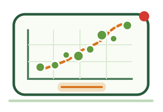

[Extensão](extensao.qmd) / Capacitação em Epidemiologia e Análise de Dados

  

    INICIATIVA DE FORMAÇÃO · GPENSC
    <h2>Formação para compreender dados e produzir evidências em saúde</h2>
    
A capacitação em epidemiologia e análise de dados integra as iniciativas de extensão mencionadas no planejamento do GPENSC.

    <a class="gp-project-button" href="agenda.html">Consultar próximas atividades</a>
  

  

## A proposta de formação

A epidemiologia e a análise de dados oferecem ferramentas para formular perguntas, interpretar indicadores e compreender problemas de saúde coletiva. Esta página apresenta o tema da iniciativa enquanto são reunidas as informações oficiais de sua programação.

  
01<h3>Investigação</h3>
Perguntas de pesquisa, tipos de estudo e princípios da epidemiologia.

  
02<h3>Dados</h3>
Organização, leitura e interpretação crítica de informações em saúde.

  
03<h3>Aplicação</h3>
Uso responsável das evidências em pesquisa, formação e serviços.

## Programação e participação

Conteúdos, datas, público-alvo, inscrições e responsáveis serão apresentados quando confirmados pela coordenação. Até lá, consulte a [Agenda GPENSC](agenda.qmd) ou [entre em contato](contato.qmd).

**Identidade visual:** esta página utiliza uma ilustração editorial temática. Não foi inserida uma marca supostamente oficial sem os arquivos de referência do projeto.

[Voltar à área de extensão](extensao.qmd){.btn .btn-secondary}
