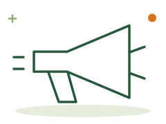

<div class="gp-illustrated-lead"><p>Produções científicas e materiais do GPENSC para a comunidade acadêmica e a sociedade.</p></div>

## Explore os conteúdos

```{=html}
<nav class="gp-research-index" aria-label="Áreas de divulgação científica">
<a href="biblioteca.html"><strong>Biblioteca</strong><span>Cartilhas, materiais educativos, livros, e-books e anuários</span></a>
<a href="multimidia.html"><strong>Multimídia</strong><span>Podcasts, vídeos, entrevistas e episódios do GPENSC no Ar</span></a>
<a href="ciencia-sociedade.html"><strong>Ciência para a sociedade</strong><span>Resultados científicos acessíveis e impacto social</span></a>
</nav>
```

Acompanhe também as [notícias e novidades do GPENSC](noticias.qmd). A [Agenda](agenda.qmd) reúne os próximos eventos e atividades do grupo.

```{=html}
<script>
/* Redireciona links compartilhados anteriormente para a seção equivalente na nova organização. */
(() => {
  const paginas = {
    '#materiais': 'biblioteca.html#materiais',
    '#livros': 'biblioteca.html#livros',
    '#anuario': 'biblioteca.html#anuario',
    '#podcasts': 'multimidia.html#podcasts',
    '#videos': 'multimidia.html#videos',
    '#resultados': 'ciencia-sociedade.html#resultados',
    '#impacto': 'ciencia-sociedade.html#impacto'
  };
  const destino = paginas[window.location.hash.toLowerCase()];
  if (destino) window.location.replace(destino);
})();
</script>
```

## Publicações do Instagram {#publicacoes-instagram}

```{=html}
<link rel="stylesheet" href="js/publicacoes-instagram.css">
<section data-posts-area="conteudos" aria-label="Publicações do Instagram">
<label>Tema <select><option value="">Todos os temas</option></select></label>
<p role="status">Carregando publicações…</p>
<div class="ig-post-list"></div>
<button type="button" class="btn btn-secondary" hidden>Mostrar mais publicações</button>
</section>
<script defer src="js/publicacoes-instagram.js"></script>
```
