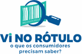
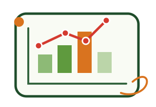

```{=html}
<div class="gp-section-illustration"><p>Conhecimento que circula entre a universidade, os serviços e a sociedade.</p></div>
```


A extensão conecta o conhecimento produzido na universidade às necessidades e aos saberes da comunidade. Conheça as iniciativas mencionadas no planejamento do GPENSC.

## Iniciativas em destaque

```{=html}
<div class="gp-ext-projects">
  <article class="gp-ext-card gp-ext-card-rotulo">
    <div class="gp-ext-art gp-ext-art-vi"><div class="gp-ext-vi-lockup"></div></div>
    <div class="gp-ext-text">
      <span class="gp-ext-kicker">ALIMENTAÇÃO E INFORMAÇÃO</span>
      <h3>Vi no Rótulo</h3>
      <p>Iniciativa ligada à educação sobre rotulagem de alimentos e à compreensão das informações presentes nas embalagens.</p>
      <a href="vi-no-rotulo.html" class="gp-ext-link">Conhecer o projeto <span aria-hidden="true">↗</span></a>
    </div>
  </article>
  <article class="gp-ext-card gp-ext-card-epi">
    <div class="gp-ext-art"></div>
    <div class="gp-ext-text">
      <span class="gp-ext-kicker">FORMAÇÃO E MÉTODOS</span>
      <h3>Capacitação em Epidemiologia e Análise de Dados</h3>
      <p>Iniciativa de formação em métodos epidemiológicos e análise de dados, conforme o planejamento apresentado pelo grupo.</p>
      <a href="capacitacao-epidemiologia.html" class="gp-ext-link">Conhecer a iniciativa <span aria-hidden="true">↗</span></a>
    </div>
  </article>
</div>
```


```{=html}
<section class="gp-ext-guide" aria-label="Como a extensão se conecta com a sociedade">
  <header class="gp-ext-guide-header">
    <span class="gp-ext-guide-label">EXTENSÃO UNIVERSITÁRIA</span>
    <h2>Ciência que se transforma em diálogo e formação</h2>
    <p>As ações de extensão aproximam a produção acadêmica das experiências e necessidades de estudantes, profissionais, serviços e comunidades.</p>
  </header>
  <div class="gp-ext-guide-grid">
    <article><span class="gp-ext-guide-icon" aria-hidden="true">01</span><h3>Públicos e participação</h3><p>Estudantes, profissionais, gestores e comunidade podem conhecer as frentes de atuação e acompanhar oportunidades divulgadas pelo grupo.</p><a href="contato.html">Entrar em contato <span aria-hidden="true">↗</span></a></article>
    <article><span class="gp-ext-guide-icon" aria-hidden="true">02</span><h3>Formação e capacitação</h3><p>Atividades de ensino e extensão ligadas a métodos de pesquisa, epidemiologia, dados e informação em alimentação e nutrição.</p><a href="capacitacao-epidemiologia.html">Conhecer a capacitação <span aria-hidden="true">↗</span></a></article>
    <article><span class="gp-ext-guide-icon" aria-hidden="true">03</span><h3>Materiais e divulgação</h3><p>Conteúdos de divulgação científica e materiais educativos que ajudam a compartilhar os temas abordados pelas iniciativas.</p><a href="materiais.html">Explorar materiais <span aria-hidden="true">↗</span></a></article>
  </div>
  <aside class="gp-ext-guide-action"><div><span class="gp-ext-guide-label">PARTICIPE E ACOMPANHE</span><h3>Conheça as atividades do GPENSC</h3><p>Confira eventos, oportunidades divulgadas e canais oficiais de contato.</p></div><div class="gp-ext-guide-buttons"><a href="agenda.html">Ver agenda <span aria-hidden="true">↗</span></a><a href="contato.html">Fale com o grupo <span aria-hidden="true">↗</span></a></div></aside>
</section>
```

## Projetos cadastrados no portfólio

```{r}
source("R/helpers.R")
projetos_extensao <- registros_reais(projetos, "titulo") |>
  dplyr::filter(tipo == "Extensão")

if (nrow(projetos_extensao)) {
  projetos_extensao |>
    dplyr::transmute(
      Projeto = titulo,
      Situação = situacao,
      Coordenação = coordenador,
      Início = inicio
    ) |>
    DT::datatable(
      rownames = FALSE,
      options = list(pageLength = 10, language = DT_PT, scrollX = TRUE)
    )
} else {
  estado_vazio("Cadastros em revisão",
    "Os dados detalhados de coordenação, período e situação aparecerão após sua confirmação pelo grupo.")
}
```

::: {.gp-ext-footer}
**Quer saber sobre as atividades abertas?** Consulte a [Agenda GPENSC](agenda.qmd) ou [entre em contato com o grupo](contato.qmd). A divulgação de datas e inscrições depende de programação confirmada.
:::
