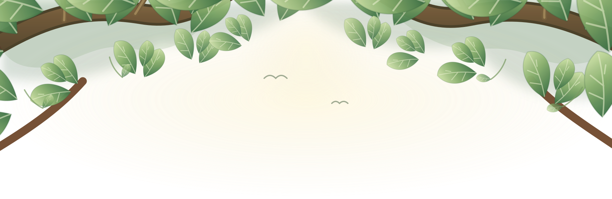
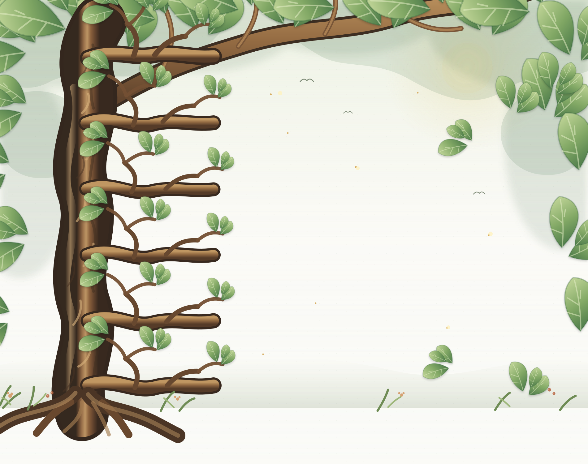

```{=html}
<div class="tree-home">
  <section class="tree-intro">
    
    <div class="tree-eyebrow"><span></span> Universidade Federal de Ouro Preto</div>
    <div class="tree-heading" role="heading" aria-level="1">
      Conhecimento que cria raízes.
      <em>Pesquisa que transforma vidas.</em>
    </div>
    <p>Uma árvore, muitos caminhos. Explore os ramos do GPENSC: cada galho se divide em novas áreas, projetos, experiências e conhecimentos.</p>
    <div class="tree-instruction"><span class="instruction-dot"></span> Escolha um galho, descubra novos brotos e siga os caminhos do conhecimento.</div>
  </section>

  <section class="tree-world" aria-label="Árvore de navegação do GPENSC">
    <div class="tree-canopy-label" aria-hidden="true">
      <span class="canopy-line"></span>
      <span>UM ECOSSISTEMA DE IDEIAS, PESSOAS E TRANSFORMAÇÃO</span>
      <span class="canopy-line"></span>
    </div>

    <div class="tree-map">
      

      <article class="tree-limb limb--left limb--group">
        <div class="limb-connector" aria-hidden="true"></div>
        <button class="limb-toggle" type="button" data-branch-toggle aria-expanded="false" aria-controls="branch-group">
          <span class="limb-symbol">01</span>
          <span class="limb-title-wrap"><strong>O grupo</strong><small>Quem somos e como nos conectamos</small></span>
          <span class="limb-plus" aria-hidden="true">+</span>
        </button>
        <div class="branch-children" id="branch-group" hidden>
          <div class="twig">
            <button type="button" class="twig-toggle" data-branch-toggle aria-expanded="false" aria-controls="group-identity"><span>Identidade e história</span><b>＋</b></button>
            <div class="twig-leaves" id="group-identity" hidden>
              <a href="sobre.html">Conheça o GPENSC</a>
              <a href="sobre.html">Nossa história</a>
            </div>
          </div>
          <div class="twig">
            <button type="button" class="twig-toggle" data-branch-toggle aria-expanded="false" aria-controls="group-people"><span>Pessoas e organização</span><b>＋</b></button>
            <div class="twig-leaves" id="group-people" hidden>
              <a href="sobre.html">Equipe e integrantes</a>
              <a href="sobre.html">Organização do grupo</a>
            </div>
          </div>
          <div class="twig">
            <button type="button" class="twig-toggle twig-direct" data-branch-toggle aria-expanded="false" aria-controls="group-contact"><span>Contato</span><b>＋</b></button>
            <div class="twig-leaves" id="group-contact" hidden>
              <a href="contato.html">Fale com o GPENSC</a>
            </div>
          </div>
        </div>
      </article>

      <article class="tree-limb limb--right limb--research">
        <div class="limb-connector" aria-hidden="true"></div>
        <button class="limb-toggle" type="button" data-branch-toggle aria-expanded="false" aria-controls="branch-research">
          <span class="limb-symbol">02</span>
          <span class="limb-title-wrap"><strong>Pesquisa</strong><small>Investigar, produzir e compartilhar ciência</small></span>
          <span class="limb-plus" aria-hidden="true">+</span>
        </button>
        <div class="branch-children" id="branch-research" hidden>
          <div class="twig">
            <button type="button" class="twig-toggle" data-branch-toggle aria-expanded="false" aria-controls="research-lines"><span>Linhas de pesquisa</span><b>＋</b></button>
            <div class="twig-leaves" id="research-lines" hidden>
              <a href="linhas.html">Conheça nossas linhas</a>
            </div>
          </div>
          <div class="twig">
            <button type="button" class="twig-toggle" data-branch-toggle aria-expanded="false" aria-controls="research-projects"><span>Projetos</span><b>＋</b></button>
            <div class="twig-leaves" id="research-projects" hidden>
              <a href="projetos.html">Projetos de pesquisa</a>
            </div>
          </div>
          <div class="twig">
            <button type="button" class="twig-toggle" data-branch-toggle aria-expanded="false" aria-controls="research-production"><span>Produção científica</span><b>＋</b></button>
            <div class="twig-leaves" id="research-production" hidden>
              <a href="publicacoes.html">Artigos e publicações</a>
              <a href="teses.html">Teses e dissertações</a>
            </div>
          </div>
        </div>
      </article>

      <article class="tree-limb limb--left limb--teaching">
        <div class="limb-connector" aria-hidden="true"></div>
        <button class="limb-toggle" type="button" data-branch-toggle aria-expanded="false" aria-controls="branch-teaching">
          <span class="limb-symbol">03</span>
          <span class="limb-title-wrap"><strong>Ensino</strong><small>Formação, orientação e aprendizagem</small></span>
          <span class="limb-plus" aria-hidden="true">+</span>
        </button>
        <div class="branch-children" id="branch-teaching" hidden>
          <div class="twig">
            <button type="button" class="twig-toggle" data-branch-toggle aria-expanded="false" aria-controls="teaching-classes"><span>Graduação</span><b>＋</b></button>
            <div class="twig-leaves" id="teaching-classes" hidden>
              <a href="disciplinas.html">Disciplinas</a>
            </div>
          </div>
          <div class="twig">
            <button type="button" class="twig-toggle" data-branch-toggle aria-expanded="false" aria-controls="teaching-guidance"><span>Orientação acadêmica</span><b>＋</b></button>
            <div class="twig-leaves" id="teaching-guidance" hidden>
              <a href="teses.html">Orientações e defesas</a>
            </div>
          </div>
          <div class="twig">
            <button type="button" class="twig-toggle" data-branch-toggle aria-expanded="false" aria-controls="teaching-materials"><span>Produção didática</span><b>＋</b></button>
            <div class="twig-leaves" id="teaching-materials" hidden>
              <a href="livros.html">Livros e capítulos</a>
            </div>
          </div>
        </div>
      </article>

      <article class="tree-limb limb--right limb--extension">
        <div class="limb-connector" aria-hidden="true"></div>
        <button class="limb-toggle" type="button" data-branch-toggle aria-expanded="false" aria-controls="branch-extension">
          <span class="limb-symbol">04</span>
          <span class="limb-title-wrap"><strong>Extensão</strong><small>Universidade em diálogo com a sociedade</small></span>
          <span class="limb-plus" aria-hidden="true">+</span>
        </button>
        <div class="branch-children" id="branch-extension" hidden>
          <div class="twig">
            <button type="button" class="twig-toggle" data-branch-toggle aria-expanded="false" aria-controls="extension-actions"><span>Projetos e ações</span><b>＋</b></button>
            <div class="twig-leaves" id="extension-actions" hidden>
              <a href="extensao.html">Projetos de extensão</a>
            </div>
          </div>
          <div class="twig">
            <button type="button" class="twig-toggle" data-branch-toggle aria-expanded="false" aria-controls="extension-media"><span>Comunicação e divulgação</span><b>＋</b></button>
            <div class="twig-leaves" id="extension-media" hidden>
              <a href="podcasts.html">Podcasts</a>
              <a href="noar.html">No Ar</a>
              <a href="videos.html">Vídeos</a>
            </div>
          </div>
        </div>
      </article>

      <article class="tree-limb limb--left limb--library">
        <div class="limb-connector" aria-hidden="true"></div>
        <button class="limb-toggle" type="button" data-branch-toggle aria-expanded="false" aria-controls="branch-library">
          <span class="limb-symbol">05</span>
          <span class="limb-title-wrap"><strong>Biblioteca</strong><small>Materiais, referências e descobertas</small></span>
          <span class="limb-plus" aria-hidden="true">+</span>
        </button>
        <div class="branch-children" id="branch-library" hidden>
          <div class="twig">
            <button type="button" class="twig-toggle" data-branch-toggle aria-expanded="false" aria-controls="library-reading"><span>Leituras</span><b>＋</b></button>
            <div class="twig-leaves" id="library-reading" hidden>
              <a href="livros.html">Livros e capítulos</a>
              <a href="publicacoes.html">Publicações do grupo</a>
            </div>
          </div>
          <div class="twig">
            <button type="button" class="twig-toggle" data-branch-toggle aria-expanded="false" aria-controls="library-media"><span>Audiovisual</span><b>＋</b></button>
            <div class="twig-leaves" id="library-media" hidden>
              <a href="videos.html">Vídeos</a>
            </div>
          </div>
          <div class="twig">
            <button type="button" class="twig-toggle" data-branch-toggle aria-expanded="false" aria-controls="library-resources"><span>Fontes e recursos</span><b>＋</b></button>
            <div class="twig-leaves" id="library-resources" hidden>
              <a href="sites.html">Sites recomendados</a>
            </div>
          </div>
        </div>
      </article>

      <article class="tree-limb limb--right limb--community">
        <div class="limb-connector" aria-hidden="true"></div>
        <button class="limb-toggle" type="button" data-branch-toggle aria-expanded="false" aria-controls="branch-community">
          <span class="limb-symbol">06</span>
          <span class="limb-title-wrap"><strong>Vida do grupo</strong><small>Encontros, notícias e caminhos compartilhados</small></span>
          <span class="limb-plus" aria-hidden="true">+</span>
        </button>
        <div class="branch-children" id="branch-community" hidden>
          <div class="twig">
            <button type="button" class="twig-toggle" data-branch-toggle aria-expanded="false" aria-controls="community-news"><span>Novidades</span><b>＋</b></button>
            <div class="twig-leaves" id="community-news" hidden>
              <a href="noticias.html">Notícias do GPENSC</a>
            </div>
          </div>
          <div class="twig">
            <button type="button" class="twig-toggle" data-branch-toggle aria-expanded="false" aria-controls="community-calendar"><span>Encontros e atividades</span><b>＋</b></button>
            <div class="twig-leaves" id="community-calendar" hidden>
              <a href="agenda.html">Agenda do grupo</a>
            </div>
          </div>
        </div>
      </article>

      <div class="tree-heart" aria-label="GPENSC, Universidade Federal de Ouro Preto">
        <span class="heart-caption">RAÍZES NA UFOP</span>
        <div class="heart-ring"></div>
        <strong>GPENSC</strong>
        <span>Nutrição e Saúde Coletiva · UFOP</span>
      </div>
    </div>

    <div class="tree-roots-caption">
      <span class="root-rule"></span>
      <span>RAÍZES QUE SUSTENTAM · CONHECIMENTO QUE FLORESCE</span>
      <span class="root-rule"></span>
    </div>
  </section>
</div>
```
