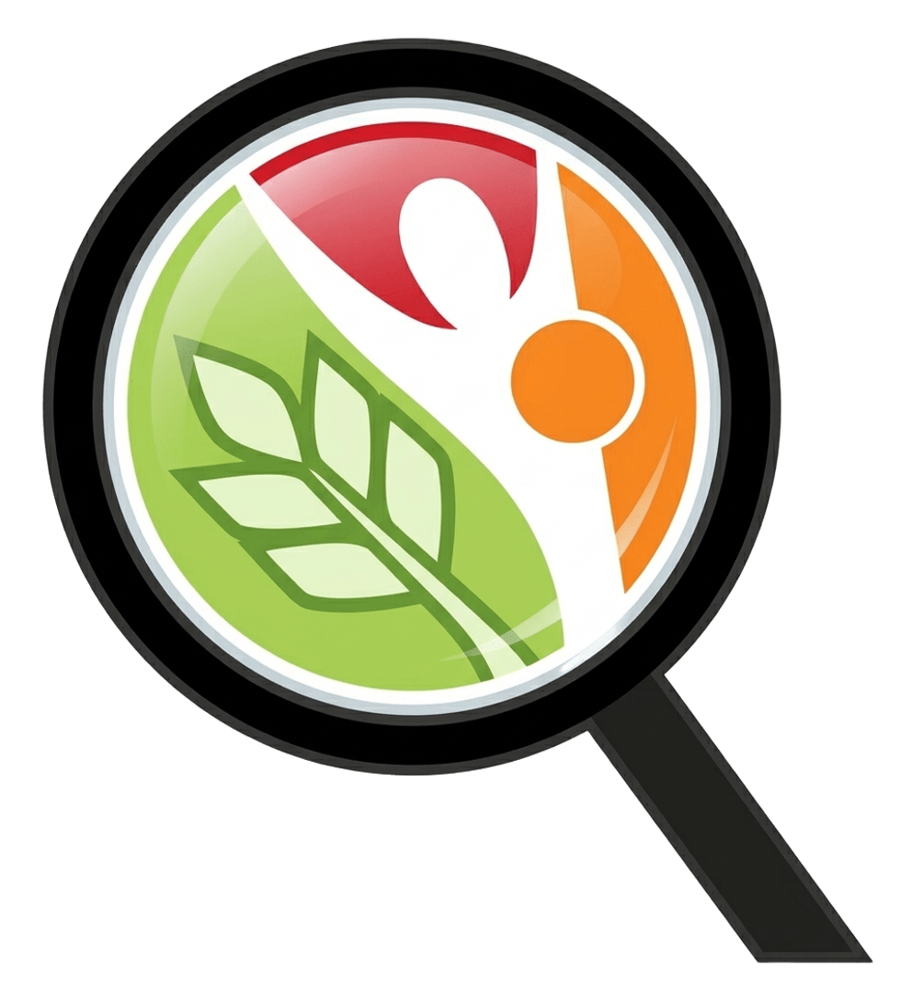

\`\`\`{=html}

  <section class="tree-intro">
    
 Universidade Federal de Ouro Preto

    

      Conhecimento que cria raízes.
      <em>Pesquisa que transforma vidas.</em>
    

    
Uma árvore, muitos caminhos. Explore os ramos do GPENSC: cada galho se divide em novas áreas, projetos, experiências e conhecimentos.

    
 Clique nos galhos para revelar seus caminhos. Abra os ramos menores para chegar aos conteúdos.

  </section>

  <section class="tree-world" aria-label="Árvore de navegação do GPENSC">
    

      RAMOS DO CONHECIMENTO
      
      RAÍZES NA UNIVERSIDADE · CONEXÕES COM A SOCIEDADE
    

    

      <svg class="tree-illustration" viewBox="0 0 1600 1100" preserveAspectRatio="none" aria-hidden="true">
        <defs>
          <linearGradient id="wood-shade" x1="0" y1="0" x2="1" y2="1">
            <stop offset="0" stop-color="#9b754d"/>
            <stop offset=".48" stop-color="#795438"/>
            <stop offset="1" stop-color="#4f392b"/>
          </linearGradient>
          <linearGradient id="leaf-shade" x1="0" y1="0" x2="1" y2="1">
            <stop offset="0" stop-color="#a8c58c"/>
            <stop offset=".55" stop-color="#65945e"/>
            <stop offset="1" stop-color="#356b49"/>
          </linearGradient>
          <linearGradient id="leaf-light" x1="0" y1="0" x2="1" y2="1">
            <stop offset="0" stop-color="#c4d8a5"/>
            <stop offset="1" stop-color="#7ca56d"/>
          </linearGradient>
        </defs>

        <g class="tree-roots">
          <path d="M800 1010 C730 1038 680 1073 590 1090 M800 1010 C860 1042 930 1070 1020 1090 M785 1025 C740 1060 720 1084 700 1100 M820 1025 C870 1060 900 1085 925 1100" />
        </g>

        <g class="tree-wood">
          <path class="wood-outline" d="M800 1085 C770 1000 820 925 795 830 C770 740 820 660 800 560 C782 465 820 370 800 255"/>
          <path class="wood-main" d="M800 1085 C770 1000 820 925 795 830 C770 740 820 660 800 560 C782 465 820 370 800 255"/>
          <path class="wood-outline branch-stroke" d="M795 815 C680 760 585 680 465 585 C390 525 330 440 230 385"/>
          <path class="wood-main branch-stroke" d="M795 815 C680 760 585 680 465 585 C390 525 330 440 230 385"/>
          <path class="wood-outline branch-stroke" d="M805 770 C930 720 1030 645 1140 560 C1230 490 1315 425 1400 365"/>
          <path class="wood-main branch-stroke" d="M805 770 C930 720 1030 645 1140 560 C1230 490 1315 425 1400 365"/>
          <path class="wood-outline branch-stroke" d="M795 625 C690 560 600 475 520 380 C470 320 420 250 365 205"/>
          <path class="wood-main branch-stroke" d="M795 625 C690 560 600 475 520 380 C470 320 420 250 365 205"/>
          <path class="wood-outline branch-stroke" d="M805 570 C920 500 1000 405 1080 315 C1125 265 1180 220 1245 190"/>
          <path class="wood-main branch-stroke" d="M805 570 C920 500 1000 405 1080 315 C1125 265 1180 220 1245 190"/>
          <path class="wood-outline branch-stroke" d="M790 900 C665 865 555 830 425 815 C355 805 290 815 225 850"/>
          <path class="wood-main branch-stroke" d="M790 900 C665 865 555 830 425 815 C355 805 290 815 225 850"/>
          <path class="wood-outline branch-stroke" d="M810 890 C930 865 1045 825 1170 805 C1245 792 1325 805 1390 840"/>
          <path class="wood-main branch-stroke" d="M810 890 C930 865 1045 825 1170 805 C1245 792 1325 805 1390 840"/>
        </g>

        <g class="tree-twigs">
          <path d="M465 585 C420 530 390 475 380 415 M465 585 C410 575 350 555 305 520 M1140 560 C1190 510 1220 455 1230 405 M1140 560 C1205 565 1270 545 1320 505 M520 380 C500 320 485 270 470 230 M520 380 C565 335 610 290 635 245 M1080 315 C1060 250 1055 220 1060 175 M1080 315 C1140 290 1195 265 1255 235 M425 815 C390 770 345 750 295 735 M425 815 C380 850 340 875 290 900 M1170 805 C1215 760 1260 735 1310 720 M1170 805 C1210 850 1260 875 1310 895" />
        </g>

        <g class="tree-foliage">
          <path d="M135 385 C170 295 280 280 345 330 C305 420 215 445 135 385Z"/>
          <path d="M300 190 C340 105 445 105 495 165 C440 240 360 250 300 190Z"/>
          <path d="M1160 175 C1225 100 1330 115 1370 195 C1300 255 1215 240 1160 175Z"/>
          <path d="M1270 365 C1325 280 1435 285 1480 355 C1425 440 1335 445 1270 365Z"/>
          <path d="M140 835 C205 755 310 765 350 845 C275 920 190 910 140 835Z"/>
          <path d="M1260 830 C1320 755 1425 770 1460 850 C1385 925 1300 915 1260 830Z"/>
          <path d="M395 275 C430 210 510 205 550 255 C510 325 440 330 395 275Z"/>
          <path d="M1035 285 C1080 215 1160 210 1200 265 C1155 330 1085 335 1035 285Z"/>
          <path d="M230 500 C270 430 350 425 390 480 C345 545 275 550 230 500Z"/>
          <path d="M1210 500 C1250 430 1330 425 1370 480 C1325 545 1255 550 1210 500Z"/>
        </g>
        <g class="tree-leaf-veins">
          <path d="M160 385 Q250 350 320 345 M340 190 Q410 160 470 165 M1195 180 Q1280 160 1345 190 M1300 370 Q1390 345 1450 355 M170 835 Q250 810 325 835 M1290 835 Q1370 810 1435 850"/>
        </g>
      </svg>

      <article class="tree-limb limb--left limb--group">
        

        <button class="limb-toggle" type="button" data-branch-toggle aria-expanded="false" aria-controls="branch-group">
          01
          <strong>O grupo</strong><small>Quem somos e como nos conectamos</small>
          +
        </button>
        

          

            <button type="button" class="twig-toggle" data-branch-toggle aria-expanded="false" aria-controls="group-identity">Identidade e história<b>＋</b></button>
            

              <a href="sobre.html">Conheça o GPENSC</a>
              <a href="sobre.html">Nossa história</a>
            

          

          

            <button type="button" class="twig-toggle" data-branch-toggle aria-expanded="false" aria-controls="group-people">Pessoas e organização<b>＋</b></button>
            

              <a href="sobre.html">Equipe e integrantes</a>
              <a href="sobre.html">Organização do grupo</a>
            

          

          

            <button type="button" class="twig-toggle twig-direct" data-branch-toggle aria-expanded="false" aria-controls="group-contact">Contato<b>＋</b></button>
            

              <a href="contato.html">Fale com o GPENSC</a>
            

          

        

      </article>

      <article class="tree-limb limb--right limb--research">
        

        <button class="limb-toggle" type="button" data-branch-toggle aria-expanded="false" aria-controls="branch-research">
          02
          <strong>Pesquisa</strong><small>Investigar, produzir e compartilhar ciência</small>
          +
        </button>
        

          

            <button type="button" class="twig-toggle" data-branch-toggle aria-expanded="false" aria-controls="research-lines">Linhas de pesquisa<b>＋</b></button>
            

              <a href="linhas.html">Conheça nossas linhas</a>
            

          

          

            <button type="button" class="twig-toggle" data-branch-toggle aria-expanded="false" aria-controls="research-projects">Projetos<b>＋</b></button>
            

              <a href="projetos.html">Projetos de pesquisa</a>
            

          

          

            <button type="button" class="twig-toggle" data-branch-toggle aria-expanded="false" aria-controls="research-production">Produção científica<b>＋</b></button>
            

              <a href="publicacoes.html">Artigos e publicações</a>
              <a href="teses.html">Teses e dissertações</a>
            

          

        

      </article>

      <article class="tree-limb limb--left limb--teaching">
        

        <button class="limb-toggle" type="button" data-branch-toggle aria-expanded="false" aria-controls="branch-teaching">
          03
          <strong>Ensino</strong><small>Formação, orientação e aprendizagem</small>
          +
        </button>
        

          

            <button type="button" class="twig-toggle" data-branch-toggle aria-expanded="false" aria-controls="teaching-classes">Graduação<b>＋</b></button>
            

              <a href="disciplinas.html">Disciplinas</a>
            

          

          

            <button type="button" class="twig-toggle" data-branch-toggle aria-expanded="false" aria-controls="teaching-guidance">Orientação acadêmica<b>＋</b></button>
            

              <a href="teses.html">Orientações e defesas</a>
            

          

          

            <button type="button" class="twig-toggle" data-branch-toggle aria-expanded="false" aria-controls="teaching-materials">Produção didática<b>＋</b></button>
            

              <a href="livros.html">Livros e capítulos</a>
            

          

        

      </article>

      <article class="tree-limb limb--right limb--extension">
        

        <button class="limb-toggle" type="button" data-branch-toggle aria-expanded="false" aria-controls="branch-extension">
          04
          <strong>Extensão</strong><small>Universidade em diálogo com a sociedade</small>
          +
        </button>
        

          

            <button type="button" class="twig-toggle" data-branch-toggle aria-expanded="false" aria-controls="extension-actions">Projetos e ações<b>＋</b></button>
            

              <a href="extensao.html">Projetos de extensão</a>
            

          

          

            <button type="button" class="twig-toggle" data-branch-toggle aria-expanded="false" aria-controls="extension-media">Comunicação e divulgação<b>＋</b></button>
            

              <a href="videos.html">Podcasts e vídeos</a>
              <a href="videos.html">Materiais audiovisuais</a>
            

          

        

      </article>

      <article class="tree-limb limb--left limb--library">
        

        <button class="limb-toggle" type="button" data-branch-toggle aria-expanded="false" aria-controls="branch-library">
          05
          <strong>Biblioteca</strong><small>Materiais, referências e descobertas</small>
          +
        </button>
        

          

            <button type="button" class="twig-toggle" data-branch-toggle aria-expanded="false" aria-controls="library-reading">Leituras<b>＋</b></button>
            

              <a href="livros.html">Livros e capítulos</a>
              <a href="publicacoes.html">Publicações do grupo</a>
            

          

          

            <button type="button" class="twig-toggle" data-branch-toggle aria-expanded="false" aria-controls="library-media">Audiovisual<b>＋</b></button>
            

              <a href="videos.html">Vídeos</a>
            

          

          

            <button type="button" class="twig-toggle" data-branch-toggle aria-expanded="false" aria-controls="library-resources">Fontes e recursos<b>＋</b></button>
            

              <a href="sites.html">Sites recomendados</a>
            

          

        

      </article>

      <article class="tree-limb limb--right limb--community">
        

        <button class="limb-toggle" type="button" data-branch-toggle aria-expanded="false" aria-controls="branch-community">
          06
          <strong>Vida do grupo</strong><small>Encontros, notícias e caminhos compartilhados</small>
          +
        </button>
        

          

            <button type="button" class="twig-toggle" data-branch-toggle aria-expanded="false" aria-controls="community-news">Novidades<b>＋</b></button>
            

              <a href="noticias.html">Notícias do GPENSC</a>
            

          

          

            <button type="button" class="twig-toggle" data-branch-toggle aria-expanded="false" aria-controls="community-calendar">Encontros e atividades<b>＋</b></button>
            

              <a href="agenda.html">Agenda do grupo</a>
            

          

        

      </article>

      

        

        <strong>GPENSC</strong>
        Nutrição e Saúde Coletiva · UFOP
      

    

    

      
      RAÍZES QUE SUSTENTAM · CONHECIMENTO QUE FLORESCE
      
    

  </section>

\`\`\`
