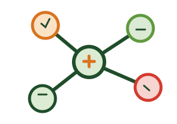

```{=html}
<div class="gp-section-illustration"><p>Explore os temas e conheça seus integrantes, projetos e trabalhos acadêmicos.</p></div>
```


```{r}
source("R/helpers.R")

linhas_publicadas <- registros_reais(linhas, "nome")
projetos_publicados <- registros_reais(projetos, "titulo")
publicacoes_publicadas <- registros_reais(pubs, "titulo")
defesas_publicadas <- registros_reais(defesas, "titulo")
integrantes_publicados <- registros_reais(equipe, "nome")

filtrar_por_linha <- function(dados, id) {
  if (nrow(dados) == 0 || !("linha_id" %in% names(dados))) {
    return(dados[0, , drop = FALSE])
  }
  dados[
    !is.na(dados$linha_id) & as.character(dados$linha_id) == as.character(id),
    ,
    drop = FALSE
  ]
}

if (secao_ativa("mostrar_linhas")) {
  if (nrow(linhas_publicadas) > 0) {
    div(
      class = "linhas-pesquisa-page",
      div(
        class = "linhas-pesquisa-grid",
        lapply(seq_len(nrow(linhas_publicadas)), function(i) {
          linha <- linhas_publicadas[i, , drop = FALSE]
          id <- as.character(linha$id[1])
          nome <- as.character(linha$nome[1])
          descricao <- valor_publico(linha$descricao)
          palavras <- valor_publico(linha$palavras_chave)
          projetos_linha <- filtrar_por_linha(projetos_publicados, id)
          publicacoes_linha <- filtrar_por_linha(publicacoes_publicadas, id)
          defesas_linha <- filtrar_por_linha(defesas_publicadas, id)
          ids_pessoa <- function(valor) {
            if (!tem(valor)) return(character())
            ids <- unlist(strsplit(as.character(valor), "[|,;]"))
            trimws(ids[nzchar(trimws(ids))])
          }
          pessoas_linha <- if (nrow(integrantes_publicados) > 0 && "linhas_ids" %in% names(integrantes_publicados)) {
            vinculados <- vapply(seq_len(nrow(integrantes_publicados)), function(j) {
              cat <- valor_publico(integrantes_publicados$categoria[j])
              !identical(cat, "Egressos") && id %in% ids_pessoa(integrantes_publicados$linhas_ids[j])
            }, logical(1))
            integrantes_publicados[vinculados, , drop = FALSE] |>
              arrange(nome)
          } else integrantes_publicados[0, , drop = FALSE]

          div(
            class = "linha-pesquisa-card",
            id = paste0("linha-", id),
            div(
              class = "linha-pesquisa-card-topo",
              span(class = "linha-pesquisa-numero", sprintf("%02d", i)),
              span(class = "linha-pesquisa-selo", "PESQUISA")
            ),
            h3(nome),
            if (!is.null(descricao)) {
              p(class = "linha-pesquisa-descricao", descricao)
            } else {
              p(
                class = "linha-pesquisa-descricao linha-pesquisa-descricao-vazia",
                "Esta linha reúne estudos e investigações desenvolvidos pelo grupo."
              )
            },
            if (!is.null(palavras)) {
              div(
                class = "linha-pesquisa-palavras",
                tags$strong("Temas: "),
                palavras
              )
            },
            div(
              class = "linha-pesquisa-equipe",
              h4("Integrantes vinculados"),
              if (nrow(pessoas_linha) > 0) {
                tags$ul(lapply(seq_len(nrow(pessoas_linha)), function(j) {
                  pessoa <- pessoas_linha[j, , drop = FALSE]
                  nome_pessoa <- as.character(pessoa$nome[1])
                  lattes_pessoa <- valor_publico(pessoa$lattes)
                  tags$li(if (!is.null(lattes_pessoa)) {
                    tags$a(nome_pessoa, href = lattes_pessoa, target = "_blank", rel = "noopener noreferrer")
                  } else {
                    tags$span(nome_pessoa)
                  })
                }))
              } else {
                p("Não há integrantes vinculados a esta linha para exibição no momento.")
              }
            ),
            tags$details(
              class = "linha-pesquisa-detalhes",
              tags$summary(
                "Ver estudos e publicações",
                tags$i(class = "bi bi-chevron-down", "aria-hidden" = "true")
              ),
              div(
                class = "linha-pesquisa-detalhes-conteudo",
                div(
                  class = "linha-pesquisa-relacionados",
                  h4("Projetos"),
                  if (nrow(projetos_linha) > 0) {
                    tags$ul(lapply(seq_len(nrow(projetos_linha)), function(j) {
                      projeto <- projetos_linha[j, , drop = FALSE]
                      tags$li(
                        tags$strong(as.character(projeto$titulo[1])),
                        if (!is.na(projeto$situacao[1]) && nzchar(as.character(projeto$situacao[1]))) {
                          tags$small(as.character(projeto$situacao[1]))
                        }
                      )
                    }))
                  } else {
                    p("Nenhum projeto vinculado a esta linha no momento.")
                  }
                ),
                div(
                  class = "linha-pesquisa-relacionados",
                  h4("Teses e dissertações"),
                  if (nrow(defesas_linha) > 0) tags$ul(lapply(seq_len(nrow(defesas_linha)), function(j) {
                    trabalho <- defesas_linha[j, , drop = FALSE]
                    url <- valor_publico(trabalho$url)
                    tags$li(if (!is.null(url) && grepl("^https?://", url)) tags$a(as.character(trabalho$titulo[1]), href = url, target = "_blank", rel = "noopener noreferrer") else tags$span(as.character(trabalho$titulo[1])))
                  })) else p("Nenhuma tese ou dissertação vinculada no momento.")
                ),
                div(
                  class = "linha-pesquisa-relacionados",
                  h4("Publicações"),
                  if (nrow(publicacoes_linha) > 0) {
                    tags$ul(lapply(seq_len(nrow(publicacoes_linha)), function(j) {
                      publicacao <- publicacoes_linha[j, , drop = FALSE]
                      titulo <- as.character(publicacao$titulo[1])
                      url <- valor_publico(publicacao$url)
                      doi <- valor_publico(publicacao$doi)
                      destino <- url
                      if (is.null(destino) && !is.null(doi)) {
                        destino <- if (grepl("^https?://", doi)) doi else paste0("https://doi.org/", doi)
                      }
                      tags$li(
                        if (!is.null(destino)) {
                          tags$a(titulo, href = destino, target = "_blank", rel = "noopener noreferrer")
                        } else {
                          tags$strong(titulo)
                        },
                        tags$small(paste(
                          c(
                            if (!is.na(publicacao$ano[1])) as.character(publicacao$ano[1]) else NULL,
                            if (!is.na(publicacao$tipo[1])) as.character(publicacao$tipo[1]) else NULL
                          ),
                          collapse = " · "
                        ))
                      )
                    }))
                  } else {
                    p("Nenhuma publicação vinculada a esta linha no momento.")
                  }
                )
              )
            )
          )
        })
      )
    )
  } else {
    estado_vazio(
      "Nenhuma linha de pesquisa disponível",
      "No momento, não há linhas de pesquisa disponíveis para consulta.",
      "Fale com o grupo",
      "contato.html"
    )
  }
} else {
  estado_vazio("Seção temporariamente indisponível", "Esta seção está desativada nas configurações do site.")
}
```
