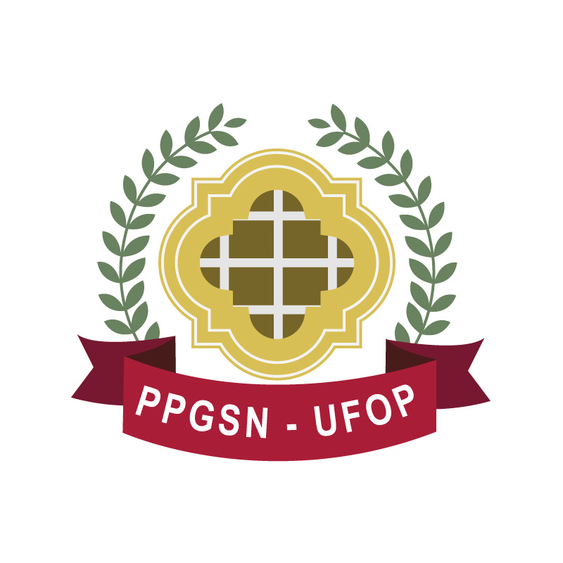

Fundado na Escola de Nutrição da UFOP, o GPENSC articula docentes, pesquisadores e estudantes na produção de conhecimento científico rigoroso e aplicado às demandas de saúde pública da comunidade.

**Missão:** Gerar e disseminar conhecimento científico em nutrição e saúde coletiva, forming profissionais capacitados e promovendo intervenções de impacto social na saúde pública.

**Objetivos:**
- Investigar determinantes sociais, epidemiológicos e nutricionais de saúde em diferentes ciclos de vida e populações.
- Fortalecer a integração entre ensino de graduação, pós-graduação e projetos de extensão comunitária.

  <a href="https://dgp.cnpq.br" target="_blank" class="btn btn-outline-success btn-sm">Página do grupo no Diretório do CNPq</a>

::: {.logos-institucionais}
{alt="PPGSN UFOP"}
{alt="Escola de Nutrição UFOP"}
:::

---

## 🔍 Coordenação

::: {.row .row-cols-1 .row-cols-md-2 .g-4 .mb-4}
::: {.col}

  
Líder do grupo

  
[Nome do Líder]

  
[Titulação, instituição e área de atuação: mini-bio de 2 a 3 linhas]

:::

::: {.col}

  
Vice-líder

  
[Nome do Vice-líder]

  
[Titulação, instituição e área de atuação: mini-bio de 2 a 3 linhas]

:::
:::

---

## 🔬 Pesquisadores e Membros

::: {.panel-tabset}

### Doutorandos

  
[Nome do Doutorando]

  
Projeto de pesquisa e linha de atuação.

### Mestrandos

  
[Nome do Mestrando]

  
Projeto de pesquisa e linha de atuação.

### Graduandos

  
[Nome do Graduando]

  
Projeto de Iniciação Científica ou Extensão.

### Egressos

  
[Nome do Egresso]

  
Atuação atual / Ano de conclusão.

:::