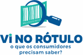

[Extensão](extensao.qmd) / Vi no Rótulo

```{=html}
<div class="gp-vi-page">
  <header class="gp-vi-hero">
    <div class="gp-vi-copy">
      <div class="gp-vi-brand">
        
        <div><span>PESQUISA E EXTENSÃO · UFOP</span><strong>Vi no Rótulo</strong></div>
      </div>
      <h2>Olhar para o rótulo é entender melhor os alimentos.</h2>
      <p>O Vi no Rótulo compartilha informações e conteúdos educativos sobre alimentos, embalagens e rotulagem nutricional, aproximando ciência e cotidiano.</p>
      <a class="gp-vi-action" href="https://www.instagram.com/vinorotulo/" target="_blank" rel="noopener noreferrer">Acompanhar @vinorotulo <span aria-hidden="true">↗</span></a>
    </div>
    <div class="gp-vi-art">
      
      <span>ROTULAGEM · INFORMAÇÃO · EDUCAÇÃO</span>
    </div>
  </header>

  <section class="gp-vi-about">
    <span class="gp-vi-label">SOBRE O PROJETO</span>
    <h2>Conhecimento para ler, comparar e compreender</h2>
    <p>O perfil institucional apresenta o Vi no Rótulo como um grupo de pesquisa e extensão vinculado à Escola de Nutrição da UFOP e coordenado pela professora Dra. Camila Carvalho Menezes.</p>
    <p>Entre as publicações divulgadas pelo projeto estão conteúdos de esclarecimento sobre rótulos de alimentos, informações nutricionais, apresentação da equipe e ações de pesquisa e extensão.</p>
  </section>

  <section class="gp-vi-topics">
    <span class="gp-vi-label">CONTEÚDOS EM DESTAQUE</span>
    <h2>Conheça os temas do Vi no Rótulo</h2>
    <div class="gp-vi-topic-cards">
      <article><span>01</span><h3>Decifrando o rótulo</h3><p>Leitura e interpretação das informações encontradas nas embalagens.</p></article>
      <article><span>02</span><h3>Rotulagem nutricional</h3><p>Conceitos e conteúdos educativos para compreender rótulos de alimentos.</p></article>
      <article><span>03</span><h3>Pesquisa e extensão</h3><p>Iniciativas, equipe e ações divulgadas nos canais do projeto.</p></article>
    </div>
  </section>

  <aside class="gp-vi-cta">
    <div><span>CANAL DO PROJETO</span><h2>Acompanhe o Vi no Rótulo</h2><p>Consulte o Instagram para verificar as publicações, a equipe e os eventos mais recentes.</p></div>
    <a href="https://www.instagram.com/vinorotulo/" target="_blank" rel="noopener noreferrer">Abrir Instagram <span aria-hidden="true">↗</span></a>
  </aside>
</div>
```


[Voltar à Extensão](extensao.qmd){.btn .btn-secondary}
